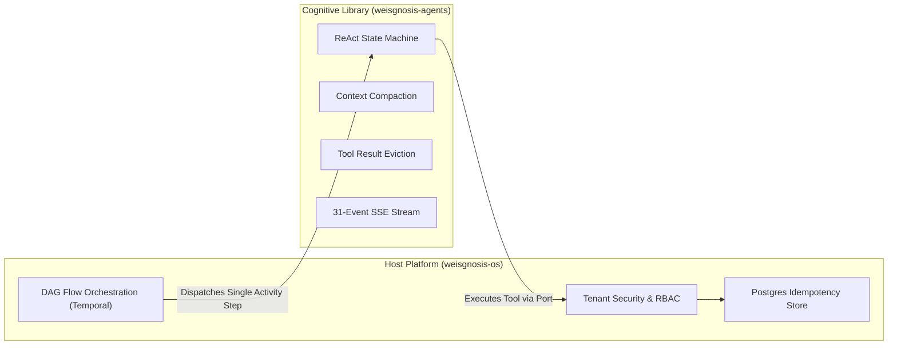

# Architecture Specification: weisgnosis-agents

> **Version:** 0.1.0-DRAFT  
> **Status:** Approved Baseline  
> **Target Environment:** Scala 3.9.0 LTS / ZIO 2.1.26+  

---

## 1. Architectural Philosophy

`weisgnosis-agents` is designed on three pillars:

1. **Stateless Cognitive Engine:** The agent engine is a pure state-transformation pipeline:
   $$\text{Run}: (\text{History}, \text{Prompt}, \text{Environment}) \longrightarrow ZStream[R, \text{AgentError}, \text{AgentEvent}]$$
   It does not manage external database sessions, Redis caches, or durable workflow replays. State persistence is the responsibility of the host orchestrator (e.g. Temporal in `weisgnosis-os`).

2. **Structured Concurrency by Default:**
   All async operations (tool calls, streaming LLM tokens, subagents) run on scoped ZIO fibers. If an agent is cancelled or times out, every child fiber, open HTTP socket, and in-flight process is interrupted immediately without resource leakage.

3. **Behavioral Parity with Industry Leaders:**
   Incorporates the hardened execution semantics of AgentScope 2.0 (Alibaba), including dangling tool reconciliation, thinking-only retry guards, and dual-mode structured outputs.

---

## 2. Macro vs. Micro Domain Separation



---

## 3. Data Models (`weisgnosis-agents-core`)

### 3.1. Messages (`Msg`)

Messages are the immutable communication primitives between agents, models, and tools:

```scala
package com.weisgnosis.agents.core.model

import zio.Chunk
import zio.json.*
import java.time.Instant

enum Role derives JsonCodec:
  case System, User, Assistant, Tool

enum ContentBlock derives JsonCodec:
  case Text(text: String)
  case Thinking(thought: String)
  case ToolUse(id: String, name: String, input: Json, isServerTool: Boolean = false)
  case ToolResult(callId: String, name: String, output: String, state: ToolResultState = ToolResultState.Success)
  case Data(mime: String, bytes: Chunk[Byte])

enum ToolResultState derives JsonCodec:
  case Success, Error, Interrupted

final case class Msg(
  id: String,
  role: Role,
  content: Chunk[ContentBlock],
  metadata: Map[String, Json] = Map.empty,
  timestamp: Instant = Instant.now()
) derives JsonCodec
```

---

### 3.2. Unified Event Hierarchy (`AgentEvent`)

The framework exposes a fine-grained, 31-event stream covering the entire reasoning and execution lifecycle:

```scala
package com.weisgnosis.agents.core.event

import zio.json.*
import java.time.Instant

enum AgentEvent derives JsonCodec:
  // Lifecycle
  case AgentStart(agentId: String, timestamp: Instant)
  case AgentEnd(agentId: String, timestamp: Instant)
  case AgentResult(agentId: String, result: String)
  
  // Model Call & Tokens
  case ModelCallStart(model: String)
  case ModelCallEnd(model: String)
  case TextBlockStart(index: Int)
  case TextBlockDelta(text: String)
  case TextBlockEnd(index: Int)
  
  // Deep Thinking / Reasoning Models
  case ThinkingBlockStart(index: Int)
  case ThinkingBlockDelta(thought: String)
  case ThinkingBlockEnd(index: Int)
  
  // Tool Calling & Execution
  case ToolCallStart(callId: String, name: String)
  case ToolCallDelta(callId: String, argumentsChunk: String)
  case ToolCallEnd(callId: String, name: String, arguments: Json)
  case ToolResultStart(callId: String)
  case ToolResultTextDelta(callId: String, text: String)
  case ToolResultEnd(callId: String, output: String, isError: Boolean)
  
  // Human-in-the-Loop & Permissions
  case RequireUserConfirm(callId: String, toolName: String, params: Json)
  case UserConfirmResult(callId: String, approved: Boolean, feedback: Option[String])
  
  // Execution Control
  case ExceedMaxIters(limit: Int)
  case RequestStop(reason: String)
  case SubagentExposed(childAgentId: String, parentAgentId: String)
  case Custom(name: String, payload: Json)
```

---

## 4. ReAct Loop State Machine

The core ReAct loop is modeled as a functional state transition:

$$\text{Step}: (S_t) \xrightarrow{\text{LLM Call}} (S_{t+1}, \text{Action})$$

Where $\text{Action} \in \{ \text{Finish}, \text{ExecuteTools}(\text{calls}), \text{AskConfirmation}(\text{call}), \text{LoopbackReminder} \}$.

### Fault-Tolerant Invariants:
1. **Dangling Tool Reconciliation:** On fiber cancellation or unexpected stop, any unfulfilled `ToolUseBlock` is resolved with `ToolResultState.Interrupted`.
2. **Thinking-Only Detection:** When an LLM produces only thinking content with no tool calls and no final text, a synthetic user reminder is appended and the loop retries (bounded by `maxIters`).
3. **Server Tool Pass-Through:** Tools with `isServerTool = true` bypass the local toolkit and complete immediately.

---

## 5. Harness Subsystems (`weisgnosis-agents-harness`)

### 5.1. `ToolResultEvictor`
Large tool outputs (e.g. file dumps, grep outputs, git diffs) consume excessive context window tokens across subsequent iterations.
- If `toolResult.output.length > maxChars`:
  1. The full output is written to a designated off-context cache.
  2. The in-memory message history replaces the output with a truncated preview.
  3. A pointer metadata `evictionKey` is attached.

### 5.2. `ConversationCompactor`
When total conversation tokens exceed the budget:
1. The message history is partitioned into `Prefix` (older turns) and `Tail` (recent $k$ turns).
2. Prior summary messages in `Prefix` are extracted and merged with new uncompacted prefix messages.
3. An LLM summarization step generates a single replacement `Msg(Role.Assistant, ContentBlock.Text("[Conversation Summary: ...]"))`.
4. The history is updated to: `SummaryMsg +: Tail`.

---

## 6. Error Handling Strategy

Recoverable errors are modeled as typed ADTs:

```scala
package com.weisgnosis.agents.core.error

enum AgentError:
  case ModelError(statusCode: Int, message: String)
  case ToolExecutionError(toolName: String, cause: String)
  case ContextLengthExceeded(currentTokens: Long, limit: Long)
  case PermissionDenied(toolName: String, reason: String)
  case MaxIterationsExceeded(iterations: Int)
  case Interrupted(message: String)
```
Unexpected programmer bugs or systemic failures (e.g. fatal OutOfMemory, linkage errors) terminate as ZIO Defects (`Die`).
