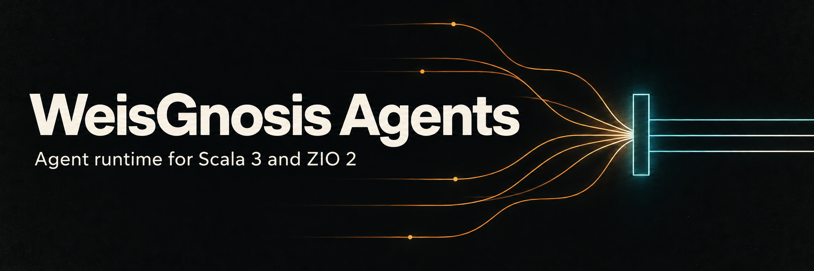
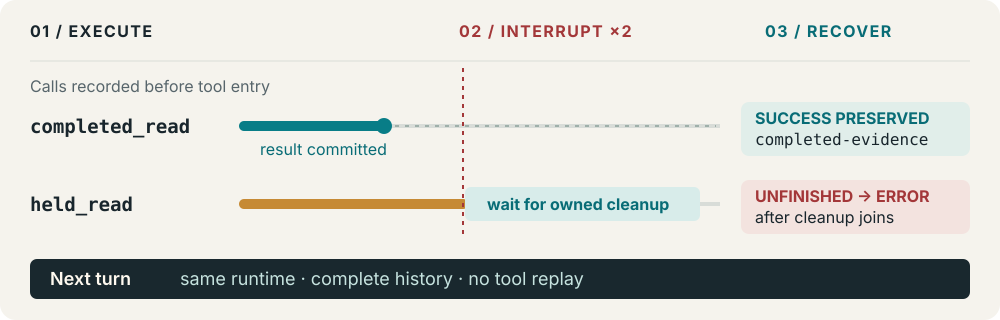
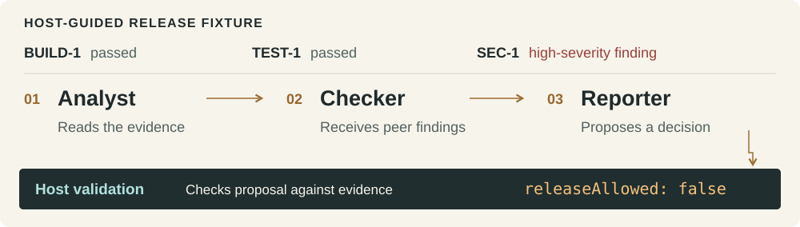

# WeisGnosis Agents

<picture>
  <source media="(max-width: 600px)" srcset="docs/assets/weisgnosis-hero-mobile.png">
  
</picture>

WeisGnosis Agents is a Scala 3 / ZIO 2 library for agents that call your service's functions and work together. Your application supplies the models and tools, controls permissions, and manages how work starts, stops and resumes.

[](https://github.com/weisgnosis/weisgnosis-agents/actions/workflows/ci.yml)
[](https://central.sonatype.com/artifact/com.weisgnosis/weisgnosis-agents-core_3)
[](https://www.scala-lang.org/)
[](https://zio.dev/)
[](LICENSE)

[**First agent**](#first-agent) · [Runtime verification](#verify-runtime-guarantees-no-credentials) · [Three-agent example](#example-release-review-with-three-agents) · [Modules](#choose-your-modules) · [API guides](docs/README.md)

<a id="quickstart"></a>

## First agent

Tested with **JDK 21 and sbt 1.12.11**; the build uses Scala 3.9.0, with no Scala 3.3 LTS build.

Add the signed development snapshot to your `build.sbt`:

<!-- first-agent-build:start -->
```scala
scalaVersion := "3.9.0"
resolvers += "Sonatype snapshots" at "https://central.sonatype.com/repository/maven-snapshots/"
libraryDependencies += "com.weisgnosis" %% "weisgnosis-agents-core" % "0.1.1-SNAPSHOT"
```
<!-- first-agent-build:end -->

Set `sbt.version=1.12.11` in `project/build.properties`. No repository credentials are needed. `0.1.1-SNAPSHOT` includes compile-time tool schemas; snapshot builds can change. See [release and snapshot installation](docs/packages.md) for other versions.

Use an OpenAI-compatible Chat Completions endpoint with streaming and tool calling. Configure these process environment variables:

| Variable | Value |
| --- | --- |
| `AGENT_ENDPOINT` | Your provider's Chat Completions URL, for example `https://api.openai.com/v1/chat/completions`. |
| `AGENT_MODEL` | A model offered by that provider with streaming and tool calling support. |
| `AGENT_API_KEY` | Your credential for that provider. |

The example leaves temperature to the provider and sends a 4,096-token output limit. Explicit sampling values remain available through `temperature` ([configuration guide](modules/core/src/main/scala/com/weisgnosis/agents/core/client/README.md#optional-temperature)). The recorded live checks used a private compatible gateway; they do not establish a live run against OpenAI's native endpoint.

Save the following as `src/main/scala/FirstAgent.scala`. It exposes one tool and asks the model to assess a release. The tool supplies fixed demonstration data; replace its handler with your service function to read real evidence.

<!-- first-agent-source:start -->
```scala
package example

import com.weisgnosis.agents.core.agent.ReActAgent
import com.weisgnosis.agents.core.client.{ChatCompletionsClient, LlmConfig, TemperaturePolicy}
import com.weisgnosis.agents.core.model.Msg
import com.weisgnosis.agents.core.tool.{Tool, ToolSchema, Toolkit}
import zio.*
import zio.http.Client
import zio.json.*

object FirstAgent extends ZIOAppDefault:
  final case class ReleaseQuery(release: String) derives JsonCodec, ToolSchema

  private val evidence: Tool[Any, ReleaseQuery, String] =
    Tool.derived[ReleaseQuery, String](
      "read_release_evidence",
      "Read build, test and security findings for a release.",
      isReadOnly = true
    )(query => ZIO.succeed(s"${query.release}: BUILD-1 passed; TEST-1 passed; SEC-1 failed: high severity"))

  def run: ZIO[Any, Throwable, Unit] =
    val program: ZIO[Client & Scope, Throwable, Unit] =
      for
        key <- ZIO.config(Config.string("AGENT_API_KEY"))
        model <- ZIO.config(Config.string("AGENT_MODEL"))
        endpoint <- ZIO.config(Config.string("AGENT_ENDPOINT"))
        http <- ZIO.service[Client]
        client <- ChatCompletionsClient.make(http)
        agent <- ReActAgent.builder()
          .client(client)
          .llmConfig(LlmConfig(
            model,
            endpoint = endpoint,
            apiKey = Some(key),
            temperaturePolicy = TemperaturePolicy.Omit,
            maxTokens = Some(4096)
          ))
          .toolkit(Toolkit.single(evidence))
          .maxIterations(4)
          .timeout(5.minutes)
          .build
        result <- agent.run(Msg.user("Use read_release_evidence for RC1 and explain whether to release."))
        _ <- Console.printLine(s"${result.state}: ${result.reply.text}")
      yield ()
    ZIO.scoped(program).provide(Client.default)
```
<!-- first-agent-source:end -->

A [compile-only CI check](verification/README.md#readme-first-agent-compilation) extracts this exact source and compiles it against freshly packaged core with no source-project dependency.

Run:

```sh
sbt "runMain example.FirstAgent"
```

An example reply is `Completed: RC1 should be blocked because SEC-1 reports a high-severity finding.` The prefix is the runtime state: `Completed`, `Suspended`, `Interrupted` or `Stopped`. The reply wording and tool selection depend on the model. This makes real API requests and can incur provider charges.

`derives ToolSchema` generates the argument schema at compile time; `Tool.derived` uses it for model declarations and runtime validation. Standard zio-json case-class codecs are supported. For custom JSON formats or extra constraints, use `Tool.fromFunction` with an explicit schema. See the [supported types and annotations](modules/core/src/main/scala/com/weisgnosis/agents/core/tool/README.md#typed-function-tools).

Native Anthropic and Gemini setup is covered in the [client guide](modules/core/src/main/scala/com/weisgnosis/agents/core/client/README.md). See the [release assistant](docs/getting-started.md#release-evidence-assistant) for a larger integration with an injected service function.

## Verify runtime guarantees (no credentials)

This offline example uses a scripted model to interrupt two running tools and check the resulting history. It is useful for evaluating cancellation behavior before connecting a provider. Clone and run:

```sh
git clone https://github.com/weisgnosis/weisgnosis-agents.git
cd weisgnosis-agents
sbt "examples / runMain com.weisgnosis.agents.examples.SyntheticRuntimeComparison"
```

The executable checks that completed results survive interruption, unfinished calls receive error results, and cancellation waits for tool cleanup. It prints a JSON receipt and exits with a failure if any check fails.

<details>
<summary><strong>Expected verification receipt</strong></summary>

```json
{
  "implementation": "scala-zio-react",
  "parallelOverlap": true,
  "callsPersistedBeforeEntry": true,
  "completedResultPreserved": true,
  "unfinishedOnlyReconciled": true,
  "cancellationJoinedCleanup": true,
  "interruptionPreserved": true,
  "recoveryExactlyOnce": true,
  "historyComplete": true,
  "sameRuntimeContinuation": true
}
```

The application emits one JSON line; the receipt above is formatted for readability. The fields record checks of call ordering, result preservation, cleanup, recovery and continuation.

</details>

[Complete executable](modules/examples/src/main/scala/com/weisgnosis/agents/examples/SyntheticRuntimeComparison.scala) · [Runtime contract](modules/core/src/main/scala/com/weisgnosis/agents/core/agent/README.md) · [Selected live-provider results](docs/live-e2e-results.md#e3-cooperative-interruption-and-same-runtime-continuation)

### Interrupting a turn with running tools

One evidence read has finished while another is still running. The application requests interruption twice. WeisGnosis keeps the finished result, waits for the second tool to release its resources, and adds an error result for its unfinished call. The next turn can continue on the same agent with a complete conversation history.

<picture>
  <source media="(max-width: 600px)" srcset="docs/assets/execution-trace-mobile.svg">
  
</picture>

<a id="multi-agent-workflows"></a>

## Example: release review with three agents

The same release evidence can pass through an **Analyst**, a **Checker** and a **Reporter**. The Analyst reads the findings; the Checker reviews them; the Reporter proposes a blocked release. The application checks that proposal against the actual tool results.

<picture>
  <source media="(max-width: 600px)" srcset="docs/assets/release-team-mobile.svg">
  
</picture>

Each agent has its own conversation. Replies from other agents become attributed context; receiving a peer's tool call does not execute that tool locally. The application chooses the order of turns and checks the final decision.

After [configuring the live environment](modules/examples/README.md#live-endpoint-verification), run:

```sh
sbt "examples / runMain com.weisgnosis.agents.examples.LiveCoordinationEvidence"
```

[Application source](modules/examples/src/main/scala/com/weisgnosis/agents/examples/LiveCoordinationEvidence.scala) · [Selected same-model and mixed-model results](docs/live-e2e-results.md#e4-useful-room-and-pipeline-evidence) · [Offline peer-conversation example](modules/examples/README.md#persistent-agent-conversation)

| Composition | How your application uses it |
| --- | --- |
| **Sequential pipeline** | Pass a completed stage's reply to the next agent. |
| **Bounded fanout** | Run independent stages concurrently with a limit, collecting results in declaration order. |
| **MsgHub** | Share attributed observations between agents with separate histories; flush queued messages between turns. |
| **Supervised subagents** | Start child tasks. An explicit supervisor owns tasks that continue after the initial wait ends. |

[Pipeline and MsgHub guide](modules/core/src/main/scala/com/weisgnosis/agents/core/coordination/README.md) · [Subagent guide](modules/harness/src/main/scala/com/weisgnosis/agents/harness/subagent/README.md)

## Why this exists

The project began with a desire to build agent applications in Scala 3. AgentScope Java was an early starting point: its approach was valuable and inspiring, but the implementation did not fit the author's needs. WeisGnosis Agents carries that inspiration into Scala and ZIO, with native data types, composable effects, explicit dependencies and scoped resources.

When a model calls a business function, the application needs to validate its arguments, authorize the action, execute it and record the outcome. WeisGnosis provides that execution layer, including interruption recovery, approval checkpoints and coordination between agents. Tool execution failures become observations the model can respond to.

Use it to embed an assistant in an existing Scala service, connect selected business operations as typed tools, or add approvals and specialist agents to a workflow. [Why Scala and ZIO](docs/scala-zio-positioning.md) explains the architectural choices.

<a id="install-what-your-host-needs"></a>

## Choose your modules

All five modules are available as signed `0.1.0-RC1` artifacts on Maven Central. Add only the modules your application needs:

| Module | Add it for |
| --- | --- |
| [core](modules/core/README.md) | Agent execution, typed tools, structured output, model clients, pipelines and MsgHub. |
| [harness](modules/harness/README.md) | Approvals, planning, context compaction, large-output storage, memory, transcripts, skills and subagents. |
| [mcp](modules/mcp/README.md) | Tools and resources from Model Context Protocol servers over stdio or HTTP. |
| [storage-postgresql](modules/storage-postgresql/README.md) | PostgreSQL persistence through a DataSource supplied by your application. |
| [otel](modules/otel/README.md) | Tracing through your application's OpenTelemetry SDK and exporter. |

Artifact names are `weisgnosis-agents-<module>`, using organization `com.weisgnosis` and Scala `%%` coordinates. See [package installation and signature verification](docs/packages.md) or [building from source](docs/getting-started.md#build-and-local-installation).

## Boundaries to know

- **Application responsibilities:** configure authorization for restricted tools; the default tool authorizer allows execution. Your application also owns authentication, business tools, deciding which worker may resume a saved checkpoint, and preventing duplicate business operations. There is no bundled general shell/file/web toolkit or RAG engine.
- **Cancellation and persistence:** cancellation waits for resources owned by the run to be released, so elapsed time can exceed its deadline. The offline example covers in-process history; external side effects are not rolled back. Stored history and checkpoints do not restart fibers or recover executing work after a process restart. Process-local approvals and hub queues need host-managed durable equivalents to survive restarts.
- **Models and providers:** Selected live results cover their documented models and configurations. Compatible endpoints and native adapters have [documented profiles](modules/core/src/main/scala/com/weisgnosis/agents/core/client/README.md); local interruption does not guarantee cancellation of remote inference.
- **Infrastructure and compatibility:** path checks are not an atomic filesystem sandbox. PostgreSQL needs an application-owned pool and schema. RC APIs may change; rebuild consumers when upgrading. Frozen binary compatibility and Scala 3.3 cross-builds are not supplied.

## Learn more and contribute

[Getting started](docs/getting-started.md) · [API guides](docs/README.md) · [Architecture](ARCHITECTURE.md) · [Live evidence](docs/live-e2e-results.md) · [Completion scope](docs/architecture/tracker.md)

Bug reports, concrete counterexamples and small working integrations are welcome. [Contributing](CONTRIBUTING.md) explains checks and independent review. [Open an issue](https://github.com/weisgnosis/weisgnosis-agents/issues) to report a problem or suggest an integration.

## License and acknowledgements

[Apache-2.0](LICENSE). Adapted agent mechanics are attributed to [AgentScope Java](https://github.com/agentscope-ai/agentscope-java); [upstream mappings](docs/architecture/test-parity.md) explain transferred behavior and intentional adaptations. WeisGnosis Agents is not a drop-in AgentScope replacement.

## Star history

<a href="https://www.star-history.com/?repos=weisgnosis%2Fweisgnosis-agents&amp;type=date&amp;legend=top-left">
  <picture>
    <source media="(prefers-color-scheme: dark)" srcset="https://api.star-history.com/chart?repos=weisgnosis/weisgnosis-agents&amp;type=date&amp;theme=dark&amp;legend=top-left">
    <source media="(prefers-color-scheme: light)" srcset="https://api.star-history.com/chart?repos=weisgnosis/weisgnosis-agents&amp;type=date&amp;legend=top-left">
    
  </picture>
</a>
