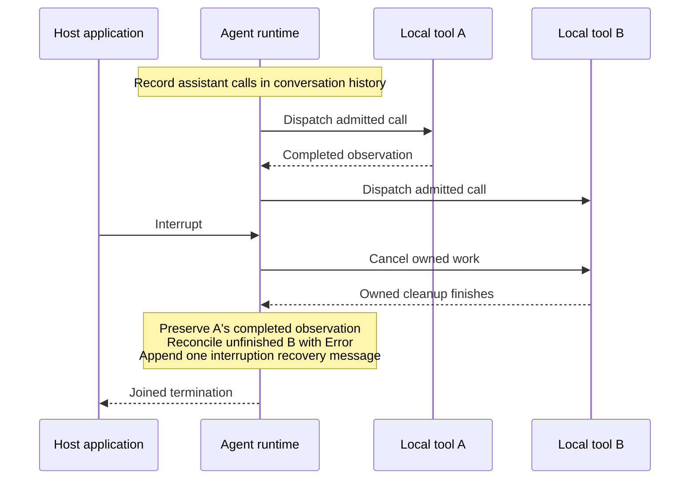

# WeisGnosis Agents

### Agent reasoning. Application control.

**Build tool-using agents and collaborating teams inside your Scala application.**
Typed Scala 3 APIs. Scoped ZIO 2 execution. Your tools, your policies, your infrastructure.

[](https://www.scala-lang.org/)
[](https://zio.dev/)
[](LICENSE)

[Run the quickstart](#quickstart) · [Build a team](#multi-agent-workflows) · [Explore the docs](docs/README.md) · [Contribute](CONTRIBUTING.md)

WeisGnosis Agents is an **embeddable agent runtime for Scala 3 and ZIO 2**. Give a model typed business tools, connect MCP servers, and compose agents into workflows. The runtime manages the reasoning/tool loop, conversation history and execution state; your application supplies dependencies and decides what may run.


> **Try the first release:** [0.1.0-RC1](https://github.com/weisgnosis/weisgnosis-agents/releases/tag/v0.1.0-RC1) is available through GitHub Packages and a downloadable Maven repository. Follow the [installation guide](docs/packages.md), or build the development snapshot below. Candidate APIs may change.

## Why this exists

A model's tool request is the start of application work: connections open, business operations execute, approvals wait, and conversation state changes. Those operations need explicit ownership, especially when a request fails or a user interrupts it.

WeisGnosis Agents brings agent execution into the same **typed, scoped effect model** as the rest of a ZIO service. Tool inputs and outputs stay connected through Scala types. Network requests and child work have owners. Permission decisions, actual tool results and runtime state determine what happened.

**The model proposes the next action. Your application retains control of execution.**

Use it for a service assistant that calls your APIs, automation that pauses for approval, or a team of specialist agents with separate conversations. Start with one agent and add context management, persistence or tracing when the application needs them.

[Runtime architecture](ARCHITECTURE.md) · [Why Scala and ZIO](docs/scala-zio-positioning.md) · [AgentScope origins](#license-and-acknowledgements)

## What you get

| Build with | So your application can… |
| --- | --- |
| **Typed tools** | Connect Scala functions to models with explicit JSON schemas, checked arguments and typed inputs/outputs. Tool execution errors become observations the model can act on. |
| **Scoped execution** | Bound model requests and agent runs; join owned cleanup on cancellation and keep completion distinct from a model's answer. |
| **Explicit authorization** | Install permission gates, approvals and Plan restrictions at tool admission. Approval policy is configured by the host; the default tool authorizer allows execution. |
| **Context management** | Compact history while preserving call/result pairs, merge summaries and offload oversized tool text while retaining the original if persistence fails. |
| **Agent collaboration** | Hand off between specialists, fan out with bounded parallelism, share attributed peer observations, or delegate to supervised subagents. |
| **Model and tool integrations** | Use OpenAI-compatible endpoints, native Anthropic/Gemini adapters and MCP tools/resources. Add PostgreSQL persistence and OpenTelemetry tracing as optional modules. |

## Quickstart

**Requirements:** JDK 21 and sbt 1.12.11. The build pins Scala 3.9.0.

### See two agents collaborate — offline

```sh
git clone https://github.com/weisgnosis/weisgnosis-agents.git
cd weisgnosis-agents
sbt "examples / runMain com.weisgnosis.agents.examples.MsgHubConversation"
```

The scripted example makes no model requests and needs no credentials. Alice shares a recommendation; Bob receives it in his own conversation and prints:

```text
Bob: Alice recommends typed outcomes and scoped resources.
```

[Read the complete example](modules/examples/src/main/scala/com/weisgnosis/agents/examples/MsgHubConversation.scala) to see agent construction and scoped hub membership.

### Embed an agent in your application

For the published candidate, follow [release installation](docs/packages.md): choose GitHub Packages or the downloadable Maven archive, then use the applications below with that dependency configuration.

To build the development snapshot instead, install core from the cloned repository:

```sh
sbt "core / publishLocal"
```

In a separate application directory, create `project/build.properties`:

```properties
sbt.version=1.12.11
```

And `build.sbt`:

```scala
scalaVersion := "3.9.0"

libraryDependencies +=
  "com.weisgnosis" %% "weisgnosis-agents-core" % "0.1.0-SNAPSHOT"
```

Save the following as `src/main/scala/ScriptedAgent.scala`:

```scala
package example

import com.weisgnosis.agents.core.agent.ReActAgent
import com.weisgnosis.agents.core.client.{LlmClient, TurnOutput}
import com.weisgnosis.agents.core.model.Msg
import zio.*

object ScriptedAgent extends ZIOAppDefault:
  def run: ZIO[Any, Throwable, Unit] =
    ZIO.scoped:
      for
        client <- LlmClient.mock(Chunk(TurnOutput.FinalText(Msg.assistant("Hello"))))
        agent <- ReActAgent.make(client = client)
        result <- agent.run(Msg.user("Hello"))
        _ <- Console.printLine(result.reply.text)
      yield ()
```

Run `sbt "runMain example.ScriptedAgent"`. It prints `Hello` without network access. This small application shows the lifecycle: create a client, construct an agent, run a turn and consume its result within an owned scope. The scripted client makes the result deterministic.

### Connect a real model and a typed tool

The complete application below gives a model a `sum` tool backed by a Scala function. It uses the same core dependency. `JsonCodec` supplies the input/output codecs; the JSON Schema is supplied explicitly.

<details>
<summary><strong>Expand the complete HTTP + tool example</strong></summary>

Save as `src/main/scala/HttpToolAgent.scala`:

```scala
package example

import com.weisgnosis.agents.core.agent.ReActAgent
import com.weisgnosis.agents.core.client.{ChatCompletionsClient, LlmConfig}
import com.weisgnosis.agents.core.error.AgentError
import com.weisgnosis.agents.core.model.Msg
import com.weisgnosis.agents.core.tool.{Tool, Toolkit}
import zio.*
import zio.http.Client
import zio.json.*
import zio.json.ast.Json

object HttpToolAgent extends ZIOAppDefault:
  final case class SumInput(a: Int, b: Int) derives JsonCodec

  private def required(name: String): ZIO[Any, Throwable, String] =
    System.env(name).flatMap(value =>
      ZIO.fromOption(value.filterNot(_.isBlank))
        .orElseFail(AgentError.InvalidConfiguration(s"Set $name"))
    )

  def run: ZIO[Any, Throwable, Unit] =
    ZIO.serviceWithZIO[Client](http =>
      ZIO.scoped:
        for
          endpoint <- required("WEISGNOSIS_EXAMPLE_ENDPOINT")
          model <- required("WEISGNOSIS_EXAMPLE_MODEL")
          key <- System.env("WEISGNOSIS_EXAMPLE_API_KEY")
          tool = Tool.fromFunction[SumInput, Long](
            "sum",
            "Add two integers.",
            Json.Obj(
              "type" -> Json.Str("object"),
              "properties" -> Json.Obj(
                "a" -> Json.Obj("type" -> Json.Str("integer")),
                "b" -> Json.Obj("type" -> Json.Str("integer"))
              ),
              "required" -> Json.Arr(Json.Str("a"), Json.Str("b")),
              "additionalProperties" -> Json.Bool(false)
            ),
            isReadOnly = true
          )(input => ZIO.succeed(input.a.toLong + input.b.toLong))
          client <- ChatCompletionsClient.make(http)
          agent <- ReActAgent.builder()
            .client(client)
            .llmConfig(LlmConfig(model, endpoint = endpoint, apiKey = key.filterNot(_.isBlank)))
            .toolkit(Toolkit.single(tool))
            .maxIterations(4)
            .timeout(1.minute)
            .build
          result <- agent.run(Msg.user("Use sum to add 2 and 3, then answer."))
          _ <- Console.printLine(s"${result.state}: ${result.reply.text}")
        yield ()
    ).provide(Client.default)
```

Set these variables in the application's process:

| Variable | Value |
| --- | --- |
| `WEISGNOSIS_EXAMPLE_ENDPOINT` | Complete compatible SSE Chat Completions URL, ending in `/chat/completions`. |
| `WEISGNOSIS_EXAMPLE_MODEL` | A tool-calling chat model available at your endpoint. |
| `WEISGNOSIS_EXAMPLE_API_KEY` | Bearer credential, if required. Keep it out of source control. |

Run `sbt "runMain example.HttpToolAgent"`. A successful tool-using run answers with the sum of 2 and 3 and prints the runtime state alongside the model's reply. The model can choose not to call the tool; this example does not assert tool execution. Real model requests may incur provider charges.

Network/provider failures fail the effect. `Completed`, `Interrupted`, `Stopped` and `Suspended` describe distinct runtime outcomes. The example selects a one-minute deadline; cancellation waits for owned cleanup, which can extend beyond that deadline.

</details>

For a checked real-tool scenario, run the [live file task](modules/examples/README.md#model-driven-file-task): a model writes and reads a disposable file, and the host verifies actual bytes, observations, completion and cleanup. For external tools, follow [MCP installation](docs/getting-started.md#owned-mcp-installation).

## When a user interrupts

Consider two local tool calls in one turn. One has finished; the other is still running. Cancellation must preserve the result already obtained and resolve the unfinished call before the conversation continues.



The runtime records assistant calls **before local execution starts**. On interruption it preserves completed observations, reconciles unfinished local calls and appends one recovery assistant message. Recording here means conversation state; durable storage is installed separately. Joined termination waits for owned cleanup and does not certify cancellation of remote inference.

[Execution and recovery contract](modules/core/src/main/scala/com/weisgnosis/agents/core/agent/README.md) · [Selected live cancellation evidence](modules/examples/README.md#selected-structured-output-and-cancellation-profiles)

## Multi-agent workflows

Use the composition that fits the work. Each agent retains its own conversation.

| Workflow | Use it when | Execution model |
| --- | --- | --- |
| **Sequential handoff** | One specialist's reply should become the next specialist's input. | Ordered stages with sender attribution. |
| **Parallel fanout** | Independent specialists can work on the same request concurrently. | Explicit parallelism limit; outcomes collected in declaration order. |
| **Message sharing with MsgHub** | Persistent agents need to hear one another's replies. | Attributed peer observations; the host chooses whose turn runs next. Busy recipients queue observations for an explicit between-round flush. |
| **Supervised subagents** | A parent needs to delegate a bounded task or promote longer work. | Scoped children, explicit supervisor ownership of promoted work and checked result delivery. |

Peer messages supply context; their embedded tool calls do not execute locally. A shared client does not imply shared agent history.

[Pipeline and MsgHub guide](modules/core/src/main/scala/com/weisgnosis/agents/core/coordination/README.md) · [Subagent guide](modules/harness/src/main/scala/com/weisgnosis/agents/harness/subagent/README.md)

## Try it

These applications exercise the public runtime rather than just describing it. Run them from the cloned repository.

| Example | Observable result |
| --- | --- |
| `sbt "examples / runMain com.weisgnosis.agents.examples.MsgHubConversation"` | Offline: Bob receives and summarizes Alice's recommendation. |
| `sbt "examples / runMain com.weisgnosis.agents.examples.LiveFileTask"` | Live model: host-supplied tools write/read a disposable file; the application checks bytes, history, completion and cleanup. |
| `sbt "examples / runMain com.weisgnosis.agents.examples.LiveCoordinationEvidence"` | Live models: sequential, parallel and mixed-model room scenarios check peer-context isolation. |

[Configure live examples](modules/examples/README.md#live-endpoint-verification) first. The [recorded results](docs/live-e2e-results.md) distinguish successful selected runs, failed profiles and untested behavior. Native-provider integration checks and live OpenAI-compatible gateway runs provide different evidence.

## Modules

**Start with core.** Add only the integrations your host needs.

| Artifact | Responsibility |
| --- | --- |
| [weisgnosis-agents-core](modules/core/README.md) | ReAct execution, messages/events, typed tools, structured output, model clients, pipelines and MsgHub. |
| [weisgnosis-agents-harness](modules/harness/README.md) | Compaction, output offload, memory, transcripts, approvals, planning, skills and supervised subagents. |
| [weisgnosis-agents-mcp](modules/mcp/README.md) | MCP tools/resources over stdio, Streamable HTTP and legacy HTTP/SSE. |
| [weisgnosis-agents-storage-postgresql](modules/storage-postgresql/README.md) | Conditional JSON persistence through a host-supplied DataSource. |
| [weisgnosis-agents-otel](modules/otel/README.md) | Tracing through a host-owned OpenTelemetry SDK/exporter. |

All artifacts use organization `com.weisgnosis` and Scala `%%` coordinates. The [published candidate](docs/packages.md) uses version `0.1.0-RC1`; the source quickstart above builds `0.1.0-SNAPSHOT`. For a local snapshot, install optional modules with `sbt "harness / publishLocal"`, `sbt "mcp / publishLocal"` or `sbt "otel / publishLocal"`, then add the matching artifact dependency. PostgreSQL also requires harness: `sbt "harness / publishLocal" "storagePostgresql / publishLocal"`.

## Boundaries to know

- **An embeddable library:** your host supplies business tools or MCP servers, authentication, durable workflow orchestration and idempotency. There is no bundled general shell/file/web toolkit or RAG engine.
- **Explicit persistence:** conversation history, process-local approvals and hub queues do not automatically survive restarts. Persistent sessions restore checked data; they do not resurrect executing fibers.
- **Explicit provider profiles:** model capabilities vary. Consult the [model adapter contracts](modules/core/src/main/scala/com/weisgnosis/agents/core/client/README.md); selected live runs do not certify every provider or profile.
- **Host-owned infrastructure:** path validation is not an atomic filesystem sandbox. PostgreSQL requires a host-owned pool/schema; uncertain writes are not automatically replayed.
- **Evolving APIs:** the first release is a candidate, available through GitHub Packages or a downloadable archive; artifacts are not published to Maven Central. Frozen binary compatibility and Scala 3.3 cross-builds are not supplied; consumers may need rebuilding after API changes.

## Learn more and contribute

| Next step | Start here |
| --- | --- |
| Build your first application | [Getting started](docs/getting-started.md) |
| Understand ownership and runtime contracts | [Architecture](ARCHITECTURE.md) |
| Find an API or integration guide | [Documentation index](docs/README.md) |
| Check implemented and remaining scope | [Single completion checklist](docs/architecture/tracker.md) |
| Propose a fix or improvement | [Contributing](CONTRIBUTING.md) · [GitHub Issues](https://github.com/weisgnosis/weisgnosis-agents/issues) |

Concrete bug reports, counterexamples and small working integrations are welcome. Run `sbt verify` to check a contribution; `sbt packageArtifacts` builds local distribution archives. [CONTRIBUTING.md](CONTRIBUTING.md) explains focused checks and independent review.

## Star history

If this is the agent runtime you have been looking for, [star the repository](https://github.com/weisgnosis/weisgnosis-agents/stargazers) to help other Scala developers find it. [View star history](https://www.star-history.com/#weisgnosis/weisgnosis-agents&Date).

## License and acknowledgements

[Apache-2.0](LICENSE). Agent mechanics are adapted from [AgentScope Java](https://github.com/agentscope-ai/agentscope-java); the [upstream mappings](docs/architecture/test-parity.md) document transferred behavior and intentional adaptations. WeisGnosis Agents uses native Scala/ZIO APIs and is not a drop-in AgentScope replacement.
