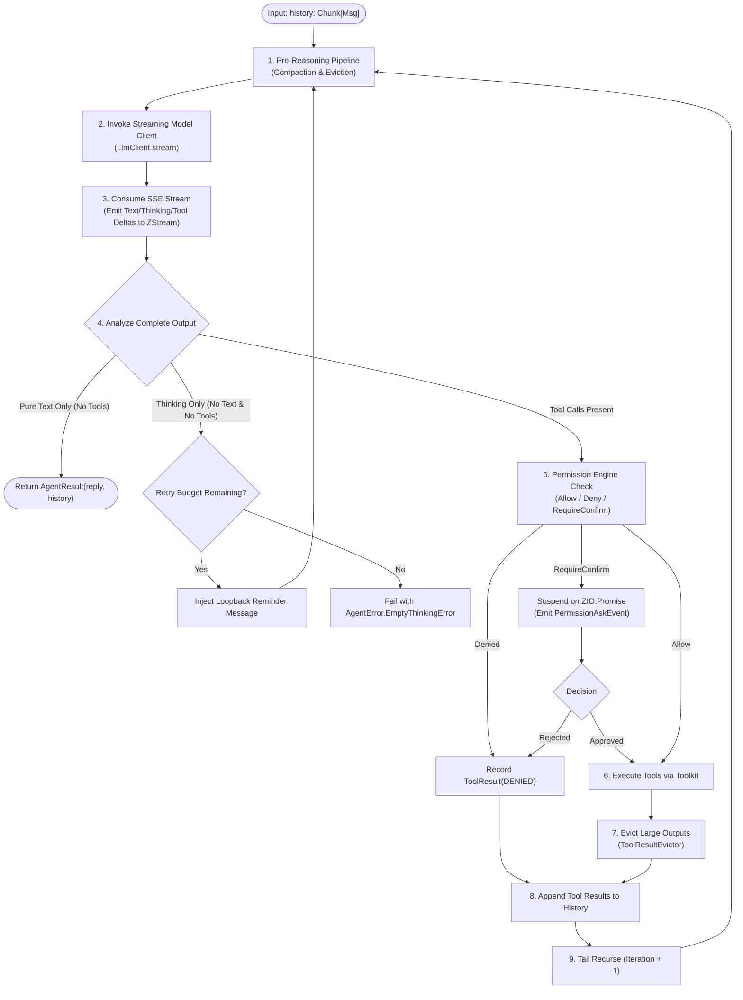
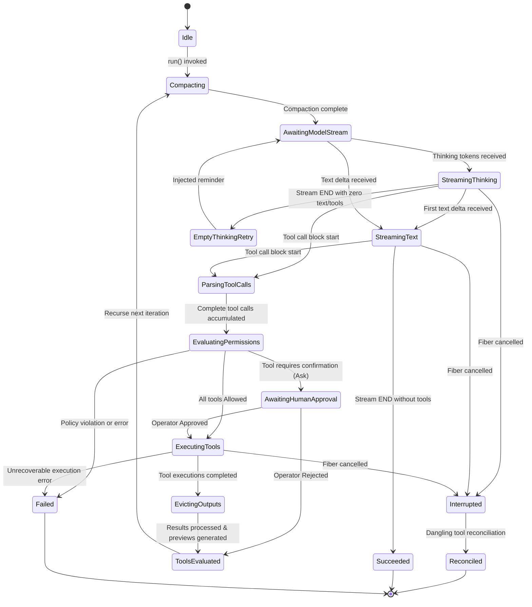
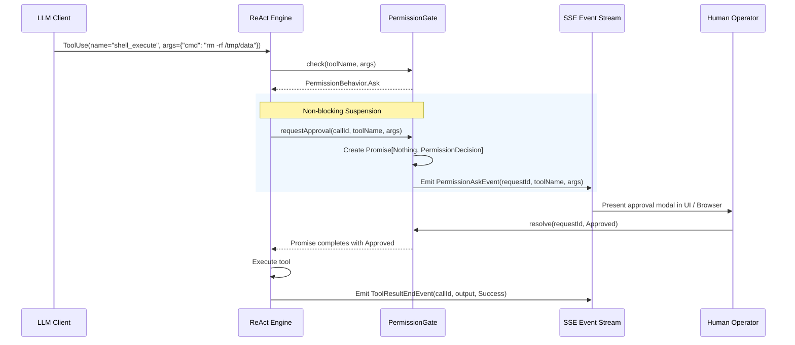

# Mid-Level Architecture Design (MLD)

> **Document:** Mid-Level Architecture Design (MLD)  
> **System:** `weisgnosis-agents`  
> **Namespace:** `com.weisgnosis.agents`  
> **Platform:** Scala 3.9.0 LTS, ZIO 2.1.26+  
> **License:** Apache-2.0  
> **Status:** Approved / Living Document  

---

## 1. The ReAct Reasoning Turn Lifecycle

The core cognitive execution unit in `weisgnosis-agents` is the tail-recursive ReAct loop. Each iteration transitions through a sequence of well-defined functional stages:



---

## 2. ReAct State Machine Specification

The agent loop models state transitions explicitly. Concurrency and interruption are handled deterministically via ZIO Fibers:



### State Definitions:
1. **`Idle`**: Agent is instantiated; waiting for user input.
2. **`Compacting`**: Evaluating token budget. If history exceeds `triggerTokens`, invokes summarization.
3. **`AwaitingModelStream`**: HTTP connection established to model endpoint.
4. **`StreamingThinking`**: Receiving and emitting reasoning tokens (`ThinkingBlockDeltaEvent`).
5. **`StreamingText`**: Receiving and emitting response content (`TextBlockDeltaEvent`).
6. **`ParsingToolCalls`**: Assembling fragmented JSON parameter chunks for tool invocations.
7. **`EvaluatingPermissions`**: Running tool requests through `PermissionGate`.
8. **`AwaitingHumanApproval`**: Execution suspended on `Promise[Nothing, PermissionDecision]`; `PermissionAskEvent` emitted.
9. **`ExecutingTools`**: Invoking tool effects in parallel or sequentially.
10. **`EvictingOutputs`**: Offloading tool outputs exceeding `maxChars` to external store; generating head/tail previews.
11. **`Interrupted`**: Fiber interruption caught via `ZIO.ensuring`. Open tool calls receive synthetic `ToolResultState.Interrupted`.

---

## 3. Streaming Event Architecture & Pipeline

`weisgnosis-agents` treats execution observability as a first-class citizen. All interactions stream through a single `ZStream[Any, AgentError, AgentEvent]`.

```
                        AGENT CORE / HARNESS
                                 │
                 ┌───────────────┴───────────────┐
                 ▼                               ▼
       Model Client Deltas              Runtime Milestones
       (Text, Thinking, Tools)       (Start, Permissions, Eviction)
                 │                               │
                 └───────────────┬───────────────┘
                                 ▼
                     ZIO Hub / Broadcast Channel
                                 │
               ┌─────────────────┴─────────────────┐
               ▼                                   ▼
        Parent Agent Stream               Child Subagent Stream
               │                                   │
               │                         (Tag with source: P/C)
               │                                   │
               └─────────────────┬─────────────────┘
                                 ▼
                    ZStream.merge (Multiplexed)
                                 │
                                 ▼
                    SSE Event Stream Formatter
                                 │
                                 ▼
                    Downstream Consumer / UI
```

### The 31 Event Classifications:
1. **Lifecycle Events (3):** `AgentStartEvent`, `AgentEndEvent`, `AgentProgressEvent`.
2. **Text Streaming Events (3):** `TextBlockStartEvent`, `TextBlockDeltaEvent`, `TextBlockEndEvent`.
3. **Reasoning Events (3):** `ThinkingBlockStartEvent`, `ThinkingBlockDeltaEvent`, `ThinkingBlockEndEvent`.
4. **Tool Call Events (3):** `ToolCallStartEvent`, `ToolCallDeltaEvent`, `ToolCallEndEvent`.
5. **Tool Result Events (3):** `ToolResultStartEvent`, `ToolResultDeltaEvent`, `ToolResultEndEvent`.
6. **Raw Model Events (3):** `ModelRequestStartEvent`, `ModelResponseChunkEvent`, `ModelResponseEndEvent`.
7. **Subagent Events (4):** `SubagentSpawnEvent`, `SubagentStartEvent`, `SubagentEndEvent`, `SubagentExposedEvent`.
8. **Security & HITL Events (2):** `PermissionAskEvent`, `PermissionDecisionEvent`.
9. **Memory & Context Events (3):** `CompactionStartEvent`, `CompactionEndEvent`, `HintBlockEvent`.
10. **Diagnostics & Custom Events (2):** `ErrorEvent`, `CustomEvent`.

---

## 4. Context Engineering Pipelines

### 4.1. Conversation Compactor (`ConversationCompactor`)
When conversation history grows beyond model window limits, compaction preserves context coherence.

```
Incoming History:
[System Prompt] ── [Turn 1] ── [Turn 2: Tool Call & Result] ── [Turn 3] ── [Tail Turns (Preserved)]
                                     │
                        Calculate Safe Cutoff Boundary
                                     │
        ┌────────────────────────────┴────────────────────────────┐
        ▼                                                         ▼
[Prefix to Compact]                                     [Tail to Retain]
• Extract prior __compaction_summary__                  • Never split tool turn pairs!
• LLM Generates New Single Flat Summary                 • Keeps recent 6 messages intact
        │                                                         │
        └────────────────────────────┬────────────────────────────┘
                                     ▼
Reconstructed History:
[System Prompt] ── [Summary Block: __compaction_summary__] ── [Tail to Retain]
```

#### Safe Cutoff Algorithm:
1. Identify target index: `history.length - preserveTailMessages`.
2. Boundary check: If the message at `targetIndex` is a `ToolResult` message, decrement `targetIndex` until it points to the preceding `Assistant` message containing the matching `ToolUse` block.
3. This guarantees that `Assistant(tool_calls)` and `Tool(tool_results)` are never split across the compaction boundary.

### 4.2. Tool Result Eviction (`ToolResultEvictor`)
Massive tool responses (e.g. bash commands, git diffs, file dumps) consume excessive tokens:
- **Threshold:** Output character length $> 2,000$ characters.
- **Store Offload:** Full text saved into `ToolResultStore` under unique UUID key `cache_id`.
- **In-Context Transformation:**
  ```text
  <head preview: 800 chars>
  ... [Full output truncated: N lines (K chars). Offloaded to cache: cache_id_XYZ] ...
  <tail preview: 400 chars>
  ```
- **Rationale:** Retains initialization parameters (head) and terminal error codes or success messages (tail) while purging the repetitive body.

---

## 5. Human-in-the-Loop (HITL) Architecture



---

## 6. Subagent Coordination & Scoped Fibers

Subagents execute on child ZIO fibers within the parent agent's `Scope`:
- **Spawn Primitive:** `agent_spawn(agentId, prompt, options)`.
- **Structured Scoping:** Child fibers are spawned via `forkScoped`. If the parent agent is canceled, all descendant subagent fibers are interrupted automatically.
- **Recursion Guard:** `currentDepth < MAX_SPAWN_DEPTH (3)`. Any spawn request exceeding depth 3 is rejected immediately with an execution error.
- **Event Tagging:** Child streams are merged with the parent stream via `ZStream.merge`. Each child event is modified:
  `event.withSource(s"$parentSessionId/$childAgentId")`.
- **Synchronous Timeout Promotion:** If a subagent call is requested synchronously but exceeds 30 seconds, it is promoted to a background task, returning a `taskId` to the parent without failing the reasoning step.

---

## 7. Plan Mode Subsystem

`PlanMode` prevents accidental modification of critical infrastructure during reasoning:
1. **Activation:** Model or operator invokes `plan_enter`.
2. **Tool Interception:**
   - Permitted: Read-only tools (`read_file`, `grep`, `find`), draft tools (`plan_write`, `todo_write`), and child delegation (`agent_spawn`).
   - Prohibited: Mutation tools (`write_file`, `edit_file`, destructive shell commands).
   - Invariant: Prohibited invocations receive `ToolResultState.Denied` with a descriptive message prompting the model to draft a plan or call `plan_exit`.
3. **Deactivation Barrier:** `plan_exit` **strictly** requires operator confirmation via `PermissionGate`. An agent cannot unilaterally authorize its own transition into execution phase.
