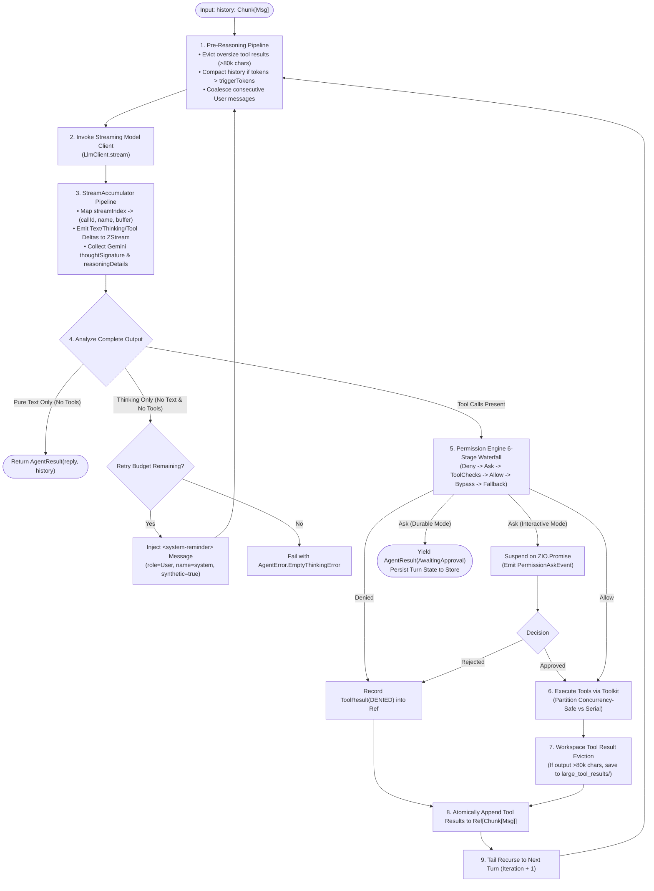
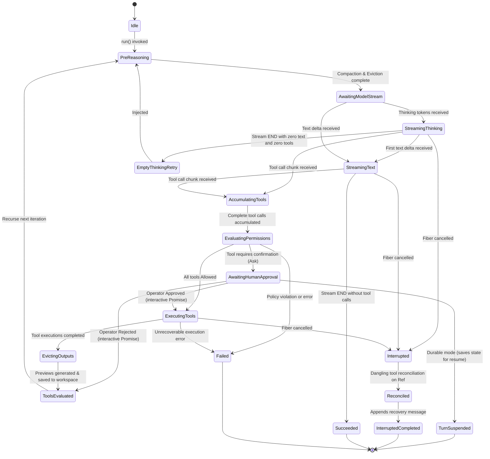
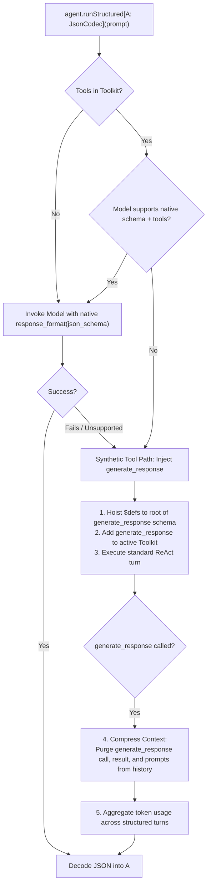

# Mid-Level Architecture Design (MLD)

> **Document:** Mid-Level Architecture Design (MLD)  
> **System:** `weisgnosis-agents`  
> **Namespace:** `com.weisgnosis.agents`  
> **Platform:** Scala 3.9.0 LTS, ZIO 2.1.26+  
> **License:** Apache-2.0  
> **Status:** Approved / Living Document  

---

## 1. The ReAct Reasoning Turn Lifecycle

The core cognitive execution unit in `weisgnosis-agents` is the tail-recursive ReAct loop. In production, turn execution is protected by pre-reasoning context filters, streaming chunk accumulators, permission evaluation waterfalls, and cancellation finalizers:



---

## 2. ReAct State Machine Specification



### State Definitions & Error Recovery:
1. **`Idle`**: Agent instantiated; waiting for task invocation.
2. **`PreReasoning`**: Evaluates token budget; runs token-based binary search cutoff; prunes older tool results/arguments; coalesces consecutive `User` messages.
3. **`AccumulatingTools`**: Assembles fragmented arguments across chunks using `streamIndex`. Sanitizes incomplete JSON to `{}` on interruption.
4. **`EvaluatingPermissions`**: Evaluates tool calls against the 6-stage permission waterfall.
5. **`AwaitingHumanApproval`**:
   - *Interactive Mode:* Suspends in-memory fiber via `Promise[Nothing, ConfirmResult]`.
   - *Durable Mode:* Completes turn with `AgentResult(state = AwaitingApproval)`. The caller resumes execution with `ConfirmResult` (supporting edited input and learned rules) without re-invoking the model.
6. **`ExecutingTools`**: Partitions tool calls: concurrency-safe tools run in parallel via `ZIO.foreachPar`; mutating tools run serially.
7. **`EvictingOutputs`**: Inspects outputs $>80,000$ characters, writes raw output to `large_tool_results/`, and injects 2k/2k previews with `read_file` instructions.
8. **`Interrupted`**: Interception via `ZIO.uninterruptibleMask`. Extracts pending tool calls from `Ref[Chunk[Msg]]`, synthesizes `ToolResultState.Interrupted`, appends recovery message, and returns clean state.

---

## 3. Streaming Chunk Accumulator: Index vs. ID Resolution

When consuming OpenAI-compatible SSE streams, parallel tool calls arrive with fragmented deltas:
- **Chunk 1:** `index: 0, id: "call_abc", name: "tool_1", arguments: "{\"f"`
- **Chunk 2:** `index: 1, id: "call_def", name: "tool_2", arguments: "{\"p"`
- **Chunk 3:** `index: 0, id: null, name: null, arguments: "ile\": \"a"`
- **Chunk 4:** `index: 1, id: null, name: null, arguments: "ath\": \"b"`

```
SSE Stream Chunk ──► [streamIndex] ──► Lookup Builder in Map[Int, ToolCallBuilder]
                                      │
                                      ├─► If chunk has ID: register callId & toolName
                                      ├─► Append arguments fragment to rawContent buffer
                                      └─► Emit ToolCallDeltaEvent(callId, delta, streamIndex)
```

### Accumulator Invariants:
1. **Index-Based Keying:** Fragments are strictly grouped by `streamIndex`, preventing corrupted payloads when parallel chunks interleave.
2. **Null-Safe JSON Merging:** Partial JSON chunks with null values do not overwrite prior populated keys.
3. **Cancellation Sanitization:** If stream is interrupted mid-payload (e.g. `{"query": "hel...`), the builder tests `JsonUtils.isValidJsonObject`. If invalid, it sanitizes the payload to `{}` so downstream parsers never crash on malformed JSON.

---

## 4. Multi-Tool Dangling Reconciliation

When an assistant message emits $N$ parallel tool calls and the execution fiber is interrupted while $M < N$ tools have completed:

```
[AssistantMessage: ToolCalls(T1, T2, T3, T4, T5)] ──► Saved immediately into Ref[Chunk[Msg]]
         │
         ├── T1 completes ──► Atomically append ToolResult(T1, SUCCESS) to Ref
         ├── T2 completes ──► Atomically append ToolResult(T2, SUCCESS) to Ref
         │
    [ INTERRUPT SIGNAL ARRIVES ]
         │
         ▼
ZIO.uninterruptibleMask:
  1. Read Ref[Chunk[Msg]]
  2. existingIds = { "T1", "T2" }
  3. pendingCalls = [T3, T4, T5] (filtered: !isServerTool && !existingIds.contains(id))
  4. For each pending call:
       Append Msg(role = Tool, content = ToolResult(id, name, "Interrupted", INTERRUPTED))
  5. Append Msg.assistant("I noticed that you have interrupted me. What can I do for you?")
  6. Return AgentResult(recoveryMsg, reconciledHistory, iteration)
```

This guarantees:
- **Zero Lost Work:** `T1` and `T2` results are preserved.
- **Provider API Integrity:** Every `tool_call_id` in the assistant turn has a matching `tool` result turn.
- **No Hangs on Next Turn:** The recovery message closes the turn cleanly.

---

## 5. Structured Output Dual-Engine

`ReActAgent` supports strongly-typed structured output generation:



### The `generate_response` Tool Schema:
```json
{
  "name": "generate_response",
  "description": "Generate the final structured response. Call this function when you have all the information needed.",
  "parameters": {
    "type": "object",
    "properties": {
      "response": { <targetJsonSchema> }
    },
    "required": ["response"],
    "$defs": { <hoistedDefinitions> }
  }
}
```

---

## 6. Context Engineering & Memory Compaction

### 6.1 Two-Stage Output Pruning & Eviction

```
                      TOOL OUTPUT (e.g. bash, git diff)
                                      │
               ┌──────────────────────┴──────────────────────┐
               ▼                                             ▼
[ Immediate Turn Eviction ]                      [ Compactor History Pruning ]
Trigger: output.length > 80,000 chars            Trigger: history tokens > triggerTokens
Target: Workspace file                            Target: Older tool results (>2,000 chars)
Path: large_tool_results/agent/callId-hash        Prune: 1k head + "... pruned ..." + 1k tail
In-Context: 2,000 head / 2,000 tail preview       Argument Truncation: Older tool call args
Instruction: "Use read_file to inspect..."        truncated if >2,000 chars (e.g. write_file)
Excludes: read_file, write_file, edit_file
```

### 6.2 `ConversationCompactor` Safe Cutoff Algorithm
To determine where to split history `[0, cutoff)` (summarized) and `[cutoff, length)` (retained):

1. **Target Boundary:**
   - Binary search over `[0, history.length]` to find index where tokens in `[mid, length)` $\le \text{keepTokens}$.
   - Clamp: `cutoff = Math.min(candidate, history.length - 1)`.
2. **Consecutive Tool Scanning:**
   - If `history(cutoff).role == Role.Tool`:
     - Scan forward to collect all consecutive tool result IDs: `toolCallIds`.
     - Scan backward from `cutoff - 1` down to `0` for an `Assistant` message containing matching `ToolUse` IDs.
     - If matching assistant message found at index `i`, set `cutoff = i` (preserves assistant call and all its tool results together in the tail).
     - **Forward Fallback (Orphaned Tools):** If no matching assistant message exists, set `cutoff = forwardScanIndex` (drops orphaned tool results into the summarized prefix to prevent invalid tail starting with tool results).
3. **Consecutive User Turn Coalescing:**
   - Prepending the new summary message (`Role.User`) before a tail that starts with `Role.User` would create consecutive user turns (`[User(Summary), User(Prompt)]`), violating API turn-alternation rules (e.g. Anthropic 400).
   - If `history(cutoff).role == Role.User`, the compactor coalesces the summary with the user message into a single `User` message or injects an intermediate synthetic assistant acknowledgement.

---

## 7. Two-Layer Memory Architecture

```
[ Conversation History ]
           │
           ├──────────────────────────────────────────┐
           ▼ (Turn End / Compaction)                  ▼ (Scheduled Consolidator)
┌──────────────────────────────────────┐   ┌──────────────────────────────────────┐
│ Daily Scratchpad                     │   │ Curated Long-Term Memory             │
│ Path: memory/YYYY-MM-DD.md           │   │ Path: MEMORY.md                      │
│                                      │   │                                      │
│ • Writer: MemoryFlushManager         │   │ • Writer: MemoryConsolidator         │
│ • Append-only timestamped bullets    │   │ • Rewritten, deduplicated, curated   │
│ • Reads MEMORY.md as read-only ctx   │   │ • Budget: <4,000 tokens              │
│ • Ignores NO_REPLY responses         │   │ • Reads memory/*.md > watermark      │
│ • Coalesced per (agentId, sessionId) │   │ • Watermark in .consolidation_state  │
└──────────────────────────────────────┘   └──────────────────────────────────────┘
```

---

## 8. Dual-Mode Human-in-the-Loop (HITL) Engine

```mermaid
sequenceDiagram
    participant Model as LLM Client
    participant Agent as ReAct Engine
    participant Gate as PermissionEngine
    participant Store as Session Store
    participant Operator as Human Operator

    Model->>Agent: ToolUse("shell_execute", {"cmd": "rm -rf /"})
    Agent->>Gate: check(toolName, input)
    Gate-->>Agent: PermissionBehavior.Ask

    alt Interactive Mode (Local / CLI)
        Agent->>Gate: requestApproval(callId, toolName, input)
        Gate-->>Operator: Emit PermissionAskEvent(requestId, toolName, input)
        Operator->>Gate: resolve(requestId, ConfirmResult(confirmed=true, modifiedInput=...))
        Gate-->>Agent: Returns ConfirmResult
        Agent->>Agent: Execute tool with modifiedInput
    else Durable Mode (Temporal Activity / Webhook)
        Agent->>Store: Save partial turn state + pending request
        Agent-->>Operator: Yield AgentResult(state = AwaitingApproval, pendingCalls = [...])
        Note over Agent,Operator: Activity finishes; Temporal waits for Signal
        Operator->>Agent: resume(ConfirmResult(confirmed=true, modifiedInput=..., newRules=...))
        Agent->>Agent: Execute pending tools without re-prompting model
        Agent->>Agent: Recurse to next reasoning turn
    end
```

---

## 9. Subagent Coordination & Task Supervisor

1. **Fiber Scoping:**
   - In-turn synchronous subagents are spawned in the turn's `Scope` via `forkScoped`.
   - Bounded recursion: `currentDepth < MAX_SPAWN_DEPTH (3)`.
2. **Synchronous Timeout Promotion (30s):**
   - If a subagent does not complete within 30 seconds, it is promoted to a background task.
   - **Supervisor Scope Invariant:** Promoted tasks are detached from the turn's scope and transitioned into a persistent `TaskSupervisor` scope. Closing the parent turn scope does NOT cancel promoted background fibers.
   - The parent turn receives: `task_id: <uuid>, status: accepted`.
3. **Background Task Inspection Tools:**
   - `task_output(taskId, block: Boolean)`: Fetches progress and final output.
   - `task_list()`: Lists all active and completed background tasks.
   - `task_cancel(taskId)`: Terminates a background subagent fiber.

---

## 10. Plan Mode & Shell Hardening

`PlanMode` locks down the workspace against unapproved mutations:
1. **Allowed Tools (`ALWAYS_ALLOWED`):**
   `plan_enter`, `plan_write`, `plan_exit`, `todo_write`, `agent_spawn`, `agent_send`, `read_file`, `grep`, `find`.
2. **Mutating Tools Denied:**
   `write_file`, `edit_file` receive `ToolResultState.Denied` with instructions to use `plan_write` or call `plan_exit`.
3. **Hardened Shell Command Classifier:**
   If shell execution is permitted for exploration, `PlanModeInterceptor` runs static inspection on the command string:
   - **Allowed:** `ls`, `cat`, `head`, `tail`, `grep`, `git status`, `git diff`, `git log`, `find`.
   - **Denied:** Output redirection (`>`, `>>`), pipes to mutating tools (`| rm`, `| sh`), mutating commands (`rm`, `mv`, `cp`, `chmod`, `sed -i`, `touch`).
4. **Mandatory Exit Gate:** `plan_exit` **strictly** invokes `PermissionBehavior.Ask`.
