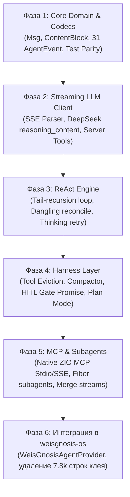

# Глубокий ресерч источника и гайд портирования: `weisgnosis-agents`

> **Документ:** Архитектурно-исследовательский отчет и руководство по портированию  
> **Оригинальная система:** AgentScope Java 2.0.2 / 2.0.3 (Alibaba)  
> **Целевая система:** `weisgnosis-agents` (Scala 3.9.0 LTS + ZIO 2.1.26+)  
> **Лицензия:** Apache-2.0  
> **Дата обновления:** Сентябрь 2026  

---

## 1. Количественная оценка кодовой базы (LOC Forecast)

Оригинальный репозиторий AgentScope Java насчитывает **>600 000 строк кода** в 96 модулях Maven. Суть проекта сосредоточена в `agentscope-core` (96k SLOC) и `agentscope-harness` (60k SLOC). Огромная масса кода — это бойлерплейт Java (геттеры, сеттеры, билдеры, Jackson-аннотации), самодельные очереди задач и платформенные адаптеры.

### 1.1. Сравнительный расчет SLOC по подсистемам

| Подсистема / Модуль | Исходный Java SLOC | Назначение в источнике | Планируемый Scala 3.9 SLOC (Main) | Планируемый ZIO Test SLOC (Test) | Коэффициент сжатия |
| :--- | :---: | :--- | :---: | :---: | :---: |
| **Система сообщений (`msg`)** | 1 701 | `Msg`, 12 классов блоков, билдеры, копирование | **120 – 180** | **150 – 250** | **~10x** |
| **События (`event`)** | 1 397 | 35 классов событий, Jackson полиморфизм | **100 – 150** | **150 – 200** | **~10x** |
| **Движок инструментов (`tool`)** | 3 676 | Рефлексия, парсинг методов, валидация | **250 – 350** | **300 – 450** | **~10x** |
| **Потоковый SSE-клиент (`client`)** | 3 030 | OkHttp/Netty, парсинг чанков, маппинг | **400 – 600** | **350 – 500** | **~6x** |
| **ReAct Loop & State Machine** | 3 898 | Reactor-цикл, прерывания, ретраи | **350 – 500** | **500 – 800** | **~8x** |
| **ИТОГО: `agents-core`** | **13 702** | *Ядро агентного цикла* | **~1 200 – 1 780** | **~1 450 – 2 200** | **~8x** |
| **Компактинг памяти (`compaction`)** | 1 051 | Саммаризация, дедупликация, сплит | **150 – 250** | **250 – 400** | **~5x** |
| **Вытеснение тулов (`eviction`)** | 500 | Замена больших аутпутов на превью | **120 – 180** | **200 – 300** | **~3x** |
| **Human-in-the-Loop (`permission`)** | 662 | Трехуровневый гейтинг, токены паузы | **150 – 220** | **250 – 350** | **~4x** |
| **Субагенты на фиберах (`subagent`)** | 2 558 | Мультиплексирование потоков, таски | **200 – 300** | **300 – 450** | **~8x** |
| **ИТОГО: `agents-harness`** | **4 771** | *Инженерная обвязка контекста* | **~620 – 950** | **~1 000 – 1 500** | **~6x** |
| **Model Context Protocol (`mcp`)** | 1 051 | JSON-RPC 2.0, Stdio & SSE транспорты | **400 – 600** | **400 – 600** | **~2.5x** |
| **ИТОГО: `agents-mcp`** | **1 051** | *Нативный ZIO MCP клиент* | **~400 – 600** | **~400 – 600** | **~2.5x** |
| **ВСЕГО ПО ПРОЕКТУ:** | **~19 524** *(суть)* | *(без учета 500k корпоративного балласта)* | **~2 220 – 3 330** | **~2 850 – 4 300** | **~7x** |

### 1.2. Итоговый объем разрабатываемого кода:
* **Продакшн-код (Main SLOC):** **2 300 – 3 300 строк**
* **Тестовый код (Test SLOC):** **2 800 – 4 300 строк**
* **Общий объем репозитория:** **~5 100 – 7 600 строк** чистейшего, типобезопасного Scala 3.9 LTS кода.
* *Для сравнения:* В `weisgnosis-os` прямо сейчас лежит **7 774 строки адаптеров** только для того, чтобы вызывать AgentScope Java. Наша библиотека целиком с тестами будет **компактнее, чем текущий адаптерный костыль!**

---

## 2. Архитектурное распутывание: Temporal (Macro) vs `weisgnosis-agents` (Micro)

Ключевой вывод исследования архитектуры AgentScope Java: **почему в коде Alibaba всё так тесно переплетено?**

В AgentScope Java не было внешнего движка надежного выполнения (Durable Execution Engine), такого как **Temporal**. В результате инженеры Alibaba были вынуждены переизобретать свой собственный половинчатый «микро-Temporal» прямо внутри JVM на базе Spring и Project Reactor:
1. **`WorkspaceTaskRepository` + JSON-файлы + 30-секундный heartbeat + свитчер орфанов (5m)** — попытка сделать Durable Tasks и восстановление после падения ноды.
2. **`MessageBus` + inbox queues + `agentscope:wakeups`** — попытка сымитировать Signal Channels и пробуждение спящих сессий.
3. **`AgentStateStore` с CAS-версионированием (`saveIfVersion`, OCC locks)** — попытка защититься от состояния гонки при параллельном обращении нескольких тредов к сессии.
4. **`PeriodicGate` + пулы `Schedulers.boundedElastic()`** — попытка сделать планировщик фоновых регламентных работ (cron).

### Разделение зон ответственности (Macro vs Micro)

```
┌────────────────────────────────────────────────────────────────────────┐
│                      weisgnosis-os (MACRO-СЛОЙ)                        │
│                                                                        │
│   • Долгоживущие Workflow Temporal (дни, недели, месяцы)               │
│   • Графы выполнения (FlowDefinition, DAG процессов)                   │
│   • Human-in-the-Loop через Temporal Signals (ожидание в браузере)     │
│   • Межсервисные транзакции (Saga), балансировка бюджета, RBAC        │
│   • Персистентность в PostgreSQL (Flyway, Doobie, Outbox Pattern)      │
│   • Тяжелые асинхронные задачи (Job Workers, фоновый рендеринг)        │
└───────────────────────────────────┬────────────────────────────────────┘
                                    │ Вызывает Activity
                                    ▼
┌────────────────────────────────────────────────────────────────────────┐
│                   weisgnosis-agents (MICRO-СЛОЙ)                       │
│                                                                        │
│   • Чистый Stateless ReAct Engine (один шаг или локальный цикл)       │
│   • ZStream из 31 строго типизированного события (SSE в реальном вр.)  │
│   • ReAct Loop: LLM -> Tool Call -> Local/MCP Execution -> History     │
│   • Защита протокола LLM (Dangling Reconcile, DeepSeek Reasoning)      │
│   • Компактинг контекста (ConversationCompactor, Tool Eviction)        │
│   • Локальные легковесные субагенты на ZIO Fibers (forkScoped/merge)   │
│   • Полная изоляция через ZIO Structured Concurrency и FiberRef        │
└────────────────────────────────────────────────────────────────────────┘
```

**Главный архитектурный принцип:**  
Библиотека `weisgnosis-agents` **НЕ содержит** собственных демонов, таймеров с `Thread.sleep`, внешних планировщиков или самодельных баз задач на диске. Она полностью детерминирована, чиста (Pure FP) и работает как эффективный вычислительный движок внутри Activity Temporal либо как автономная библиотека в CLI/сервисах.

---

## 3. Каталог скрытых краевых случаев и инвариантов (35 Hard Lessons)

Анализ 336 тестов и ключевых модулей `agentscope-core` и `agentscope-harness` выявил 35 критических краевых случаев реального продакшна, которые мы обязаны учесть:

### 3.1. Ядро агентного цикла и протоколы LLM (`agents-core`)

1. **Реконсилиация висячих вызовов инструментов при отмене (Issue #2409)**:
   * *Суть:* Если ZIO-фибер прерывается (`fiber.interrupt`, отмена Temporal активности или таймаут) в момент, когда модель вернула `ToolUseBlock`, но результат инструмента еще не записан, в истории остается «висячий вызов». OpenAI / Anthropic при следующем шаге упадут с фатальным `400 Bad Request`.
   * *Решение:* В `ZIO.ensuring` проверяется последнее сообщение: при наличии незакрытого `ToolUseBlock` синтезируется `ToolResultBlock(INTERRUPTED)`.
2. **Специфика DeepSeek: Сохранение и очистка `reasoning_content`**:
   * *Суть:* Для моделей DeepSeek-R1 / V3 протокол API требует сохранять `reasoning_content` в сообщениях ассистента, за которыми сразу следуют результаты инструментов, но удалять его из старых текстовых ходов во избежание переполнения контекста.
   * *Решение:* Функция `preserveReasoningOnlyForToolSegments(history: Chunk[Msg]): Chunk[Msg]`.
3. **Защита от «думающих в пустоту» моделей (Empty/Thinking-Only Loopback)**:
   * *Суть:* DeepSeek-R1, o1, Claude 3.7 Thinking иногда тратят тысячи токенов рассуждений, но поле `content` возвращают пустым без вызовов инструментов.
   * *Решение:* Цикл делает автоматический шаг-напоминание: *«Ты сформировал рассуждение, но не вывел ответ пользователю. Пожалуйста, предоставь итоговый ответ»*.
4. **Серверные инструменты провайдеров (`isServerTool = true`)**:
   * *Суть:* Встроенный Web Search от Anthropic или Code Execution от Gemini выполняются на серверах провайдера. В SSE вызов и результат приходят вместе.
   * *Решение:* Флаг `isServerTool` минует локальный диспетчер вызовов.
5. **Атомарность шага в компакторе контекста (Atomic Turn Pairing)**:
   * *Суть:* При отсечении (`cutoff`) старой истории нельзя разделять пару: `Assistant(tool_calls)` и следующий за ним `Tool(tool_results)`.
   * *Решение:* Алгоритм сдвигает границу влево, сохраняя целостность пар.
6. **Дедупликация старых саммари в компакторе**:
   * *Суть:* При многократном сжатии наивный алгоритм суммаризирует предыдущие саммари, получая «саммари саммари».
   * *Решение:* Извлечение существующих блоков `__compaction_summary__` и объединение с новым срезом в одно плоское первичное саммари.
7. **Вытеснение результатов инструментов (Tool Result Eviction)**:
   * *Суть:* Команда `git diff` возвращает 50k символов, сжигая контекст на каждом ходе.
   * *Решение:* Вывод длиннее `maxChars` заменяется на превью со ссылкой на кэш.
8. **Двойной движок структурированного вывода (Structured Output)**:
   * *Суть:* Если модель поддерживает нативный `response_format`, используется он; при конфликте с активными тулами инжектируется синтетический терминальный инструмент `generate_response`.

---

### 3.2. Субагенты и координация (`agents-harness`)

9. **Ограничение глубины делегирования (`MAX_SPAWN_DEPTH = 3`)**:
   * Защита от бесконечной взаимно-рекурсивной делегации между агентами.
10. **Промоушен синхронного таймаута (`AdoptedTaskRunSpec`)**:
   * При превышении синхронного таймаута (30s) задача **не отменяется**, а бесшовно переводится в фоновый фибер со статусом `timeout_promoted`, возвращая `task_id`.
11. **Гарантия закрытия потока событий субагента при отмене**:
   * В Reactor `doOnTerminate` не срабатывал на отмену, оставляя стрим висящим без `AgentEndEvent`. В ZIO это решается через `onExit` / `ensuring`.
12. **Предотвращение появления фиберов-сирот (Orphan Subagents)**:
   * Отмена родительского контекста обязана каскадно прерывать дочерние фиберы субагентов благодаря ZIO Structured Concurrency (`forkScoped`).
13. **Лимит пачки уведомлений (`MAX_DELIVERIES_PER_REMINDER = 10`)**:
   * Если в фоне завершилось 50 задач, в системное напоминание включаются максимум 10, защищая контекстное окно модели.
14. **Безопасная доставка At-Least-Once**:
   * Фоновые результаты помечаются доставленными **только после** успешного завершения шага рассуждения родителя.
15. **Автоматический отказ HITL для удаленных агентов при синхронном ожидании**:
   * Если удаленный агент запрашивает подтверждение человека при синхронном вызове без интерактивного канала, запрос автоматически отклоняется во избежание бесконечного зависания.
16. **Сквозная передача Plan Mode и правил DENY**:
   * Родительский агент принудительно синхронизирует статус Plan Mode и ограничения безопасности всем дочерним субагентам.
17. **Защита от потери контекста Reactor при `.block()` внутри тулов**:
   * В Java вызов `.block()` внутри метода тула отрывал контекст Reactor. В ZIO окружение `ZEnvironment` передается по стеку вызовов эффектов непрерывно.
18. **Детерминированные ключи персистентных сессий**:
   * Повторный спавн агента с флагом `persist_session=true` переиспользует существующий инстанс на основе детерминированного хеша `(parentSessionId, agentId, label)`.

---

### 3.3. Память, стейт-сторы и Plan Mode (`agents-harness`)

19. **Строгое разделение двух слоев памяти (Two-Layer Invariant)**:
   * `MemoryFlushManager` пишет **только** в суточный журнал `memory/YYYY-MM-DD.md`.
   * `MemoryConsolidator` является **единственным** писателем в `MEMORY.md`. Смешивание их зон ответственности приводит к деградации долговременной памяти.
20. **Асинхронные инструменты: сохранение вычисления при оффлоаде**:
   * При превышении порога ожидания тула агент получает плейсхолдер `<system-reminder>Tool '...' is running in background</system-reminder>`, но фоновый фибер продолжает работу.
21. **Обязательный плейсхолдер `ToolResultBlock` в истории**:
   * При фоновом оффлоаде синтетический результат тула обязан сразу попасть в историю, иначе валидация OpenAI/Anthropic падает.
22. **Защита от зацикливания ожидания (Anti-Spinning Guardrail)**:
   * Более 2 последовательных пустых вызовов `wait_async_results` приводят к жесткому отказу инструмента, заставляя модель продолжить полезную работу.
23. **Обязательное подтверждение человека при выходе из Plan Mode**:
   * Вызов `plan_exit` принудительно генерирует решение `PermissionDecision.ask`, блокируя переход в фазу исполнения без санкции оператора.
24. **Разрешенные мета-инструменты в режиме планирования**:
   * В Plan Mode запрещены изменения файлов (`write_file`, `edit_file`), но разрешены `plan_write`, `todo_write`, `agent_spawn` и команды чтения.
25. **Утечка версии CAS при безусловной записи (Bug #3220)**:
   * Безусловная запись (`UNVERSIONED`) обязана возвращать версию, присвоенную именно этой записи, внутри единой транзакции, иначе последующий CAS будет использовать чужую версию.
26. **Изоляция анонимного пространства имен (`__anon__`)**:
   * `userId == null` транслируется в `"__anon__"`, исключая коллизии с реальным пользователем с пустым именем `""`.
27. **Синхронный захват счетчика до ухода в асинхронность**:
   * Регистрация фоновой задачи (`begin()`) выполняется строго на вызывающем потоке до ухода в асинхронный шедулер, гарантируя корректность барьеров завершения (`awaitQuiescence`).

---

### 3.4. Песочницы и безопасность файловой системы

28. **Гонка единого слота песочницы (Issue #2490)**:
   * В AgentScope `SandboxLifecycleMiddleware` хранил `volatile Sandbox` на уровне синглтона бина, что приводило к сбоям при параллельных сессиях. В ZIO контекст изолирован в `FiberRef`.
29. **Защита от Zip Slip при распаковке снапшотов (`WorkspaceArchiveExtractor`)**:
   * Проверка абсолютных путей, сегментов `..`, нулевых байтов `\0` и проверка `dest.startsWith(canonicalRoot)`.
30. **Перенос snapshotId при падении контейнера (`carryOverPersistedSnapshotId`)**:
   * При сбое переподключения к старому контейнеру создается новый контейнер, но ему передается идентификатор предыдущего снапшота, сохраняя целостность данных воркспейса.
31. **Строгий порядок финализации: `stop()` ДО `persistState()`**:
   * `sandbox.stop()` фиксирует метаданные снапшота; сохранение состояния в хранилище обязано происходить после этого вызова.
32. **Исключение точек монтирования (`bind mounts`) из тар-снапшота**:
   * Использование аргументов `--exclude=./<rel>`, чтобы хостовые директории не запаковывались рекурсивно в снапшот контейнера.
33. **Права доступа к файлам в Docker (`0644`)**:
   * Временные файлы хоста по умолчанию создаются с маской `0600`. Команда `docker cp` сохраняет права, делая файлы нечитаемыми для non-root пользователей внутри контейнера без явного `chmod 0644`.
34. **Защита от обхода через символические ссылки (`toRealPath()`)**:
   * Проверка опасных файлов (`.ssh`, `.env`) обязана резолвить реальный путь через `toRealPath()`, предотвращая чтение секретов через симлинки.
35. **Схлопывание однотипных операций сброса памяти (Flush Coalescing)**:
   * Очередь сброса памяти схлопывает множественные запросы в рамках одного диалога в один финальный такт, читающий актуальный срез истории.

---

## 4. Таблица архитектурных трансформаций (Java/Reactor $\to$ Scala 3.9/ZIO 2)

| Механизм в Java / AgentScope | Как это было устроено (Java / Reactor) | Как это реализуется в `weisgnosis-agents` (Pure FP) |
| :--- | :--- | :--- |
| **Асинхронность** | `reactor.core.publisher.Mono[A]` | `zio.ZIO[R, AgentError, A]` |
| **Стриминг событий** | `reactor.core.publisher.Flux[Event]` | `zio.stream.ZStream[R, AgentError, AgentEvent]` |
| **Иммутабельность** | Мутабельные билдеры, `copy()` методы, сеттеры | Чистые Scala 3 `case class` с `derives JsonCodec` |
| **Контекст выполнения** | Мутабельный `RuntimeContext` с `Map[String, Object]` | `zio.ZEnvironment` + `zio.FiberRef` (нет гонок потоков) |
| **Отмена операций** | Ручной вызов `agent.interrupt()` с флагами | Автоматическая отмена фиберов ZIO Structured Concurrency |
| **Инструменты** | Java Reflection (`@Tool`, `@ToolParam`, `Method.invoke`) | Типобезопасный `Tool[R, In, Out]` с AST `zio.json.ast.Json` |
| **Human-in-the-Loop** | Сериализация состояния и остановка через `Mono.empty()` | Легковесный `zio.Promise[Nothing, ConfirmResult]` |
| **Субагенты** | `WorkspaceTaskRepository` + пулы тредов | Дочерние ZIO-фиберы (`forkScoped`) и слияние `ZStream.merge` |
| **Песочницы** | Сложные синглтон-менеджеры с `volatile Sandbox` | Скоупированный `ZIO.acquireReleaseWith` (автоочистка) |
| **Тестирование** | `reactor.test.StepVerifier` + `Thread.sleep` | `ZIOSpecDefault` + детерминированный `TestClock` |

---

## 5. План поэтапной реализации



### Фаза 1: `weisgnosis-agents-core` — Домен и кодеки
* Реализация `Role`, `ContentBlock`, `Msg`, `ToolResultState`.
* Реализация `AgentEvent` (31 строго типизированное событие с JSON-дискриминатором).
* Тесты круговой сериализации `zio-json` (Round-trip equality) со 100% паритетом с AgentScope wire DTO.

### Фаза 2: Потоковый LLM-клиент
* Интеграция с `zio-http` Client.
* Парсер SSE потоков (`data: {"choices": [...]}`).
* Выделение `ThinkingBlockDelta` и поддержка специфики DeepSeek / OpenRouter.

### Фаза 3: ReAct Engine
* Реализация хвостового рекурсивного цикла.
* Встраивание защит: реконсилиация висячих тулов при отмене, retry при thinking-only ответах.
* Двойной режим Structured Output.

### Фаза 4: `weisgnosis-agents-harness` — Память и безопасность
* `ToolResultEvictor` с сохранением превью.
* `ConversationCompactor` с атомарным сохранением пар и дедупликацией саммари.
* `PermissionGate` на базе `zio.Promise`.
* `PlanModeInterceptor` с динамической фильтрацией тулов.

### Фаза 5: `weisgnosis-agents-mcp` и Субагенты
* JSON-RPC 2.0 протокол для MCP.
* Stdio транспорт (`zio.process.Command`) и SSE транспорт (`zio-http`).
* Спавн субагентов на фиберах с автоматическим мультиплексированием `ZStream.merge`.

### Фаза 6: Интеграция в `weisgnosis-os`
* Написание компактного `WeisGnosisAgentProvider` (~200 строк).
* Удаление `AgentFactory`, `AgentScopeLocalProvider`, `ZioReactorDispatcher` (минус 7 800 строк адаптеров).
* Сквозные тесты в Temporal Activity.
