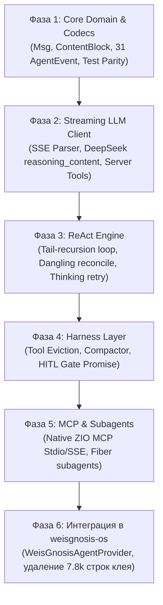

# Глубокий ресерч источника и гайд портирования: `weisgnosis-agents`

> **Документ:** Архитектурно-исследовательский отчет и руководство по портированию  
> **Оригинальная система:** AgentScope Java 2.0.2 / 2.0.3 (Alibaba)  
> **Целевая система:** `weisgnosis-agents` (Scala 3.9.0 LTS + ZIO 2.1.26+)  
> **Лицензия:** Apache-2.0  

---

## 1. Количественная оценка кодовой базы (LOC Forecast)

Оригинальный репозиторий AgentScope Java насчитывает **>600 000 строк кода** в 96 модулях. Суть проекта сосредоточена в `agentscope-core` (96k SLOC) и `agentscope-harness` (60k SLOC).

### 1.1. Сравнительный расчет SLOC по подсистемам

| Подсистема / Модуль | Исходный Java SLOC | Назначение в источнике | Планируемый Scala 3.9 SLOC (Main) | Планируемый ZIO Test SLOC (Test) | Коэффициент сжатия |
| :--- | :---: | :--- | :---: | :---: | :---: |
| **Система сообщений (`msg`)** | 1 701 | `Msg`, 12 классов блоков, билдеры, копирование | **120 – 180** | **150 – 250** | **~10x** |
| **События (`event`)** | 1 397 | 35 классов событий, Jackson полиморфизм | **100 – 150** | **150 – 200** | **~10x** |
| **Движок инструментов (`tool`)** | 3 676 | Рефлексия, парсинг методов, валидация | **250 – 350** | **300 – 450** | **~10x** |
| **Потоковый SSE-клиент (`client`)** | 3 030 | OkHttp/Netty, парсинг чанков, маппинг | **400 – 600** | **350 – 500** | **~6x** |
| **ReAct Loop & State Machine** | 3 898 | Reactor-цикл, прерывания, ретраи | **350 – 500** | **500 – 800** | **~8x** |
| **ИТОГО: `agents-core`** | **13 702** | *Ядро агентного цикла* | **~1 200 – 1 780** | **~1 450 – 2 200** | **~8x** |
| **Компактинг памяти (`compaction`)** | 1 051 | Саммаризация, дедупликация, сплит | **150 – 250** | **250 – 400** | **~5x** |
| **Вытеснение тулов (`eviction`)** | 500 | Замена больших аутпутов на превью | **120 – 180** | **200 – 300** | **~3x** |
| **Human-in-the-Loop (`permission`)** | 662 | Трехуровневый гейтинг, токены паузы | **150 – 220** | **250 – 350** | **~4x** |
| **Субагенты на фиберах (`subagent`)** | 2 558 | Мультиплексирование потоков, таски | **200 – 300** | **300 – 450** | **~8x** |
| **ИТОГО: `agents-harness`** | **4 771** | *Инженерная обвязка контекста* | **~620 – 950** | **~1 000 – 1 500** | **~6x** |
| **Model Context Protocol (`mcp`)** | 1 051 | JSON-RPC 2.0, Stdio & SSE транспорты | **400 – 600** | **400 – 600** | **~2.5x** |
| **ИТОГО: `agents-mcp`** | **1 051** | *Нативный ZIO MCP клиент* | **~400 – 600** | **~400 – 600** | **~2.5x** |
| **ВСЕГО ПО ПРОЕКТУ:** | **~19 524** *(суть)* | *(без учета 500k корпоративного балласта)* | **~2 220 – 3 330** | **~2 850 – 4 300** | **~7x** |

### 1.2. Итоговый объем разрабатываемого кода:
* **Продакшн-код (Main SLOC):** **2 300 – 3 300 строк**
* **Тестовый код (Test SLOC):** **2 800 – 4 300 строк**
* **Общий объем репозитория:** **~5 100 – 7 600 строк** чистейшего, типобезопасного Scala 3.9 LTS кода!
* *Для сравнения:* В `weisgnosis-os` прямо сейчас лежит **7 774 строки адаптеров** только для того, чтобы худо-бедно вызывать AgentScope Java. Наша библиотека целиком с тестами будет **меньше, чем текущий адаптерный костыль!**

---

## 2. Восемь критических краевых случаев источника (Hard Lessons)

Анализ 336 тестов в `agentscope-core` и `agentscope-harness` выявил неочевидные проблемы реального продакшна, которые мы обязаны учесть:

### 1. Специфика DeepSeek: Сохранение и очистка `reasoning_content`
* **Где найдено:** `DeepSeekFormatterTest.java` (пакет `extensions-model-openai`).
* **Суть проблемы:** У рассуждающих моделей (DeepSeek-R1 / V3) протокол API требует:
  1. Если в шаге $N$ ассистент сгенерировал `reasoning_content` **и** вызвал `tool_call`, то в следующем шаге $N+1$ (при передаче результата тула) этот `reasoning_content` **обязан** оставаться в истории ассистента, иначе API DeepSeek падает с ошибкой.
  2. Если же предыдущие ходы были чисто текстовыми (без вызова тулов), их `reasoning_content` **нужно вырезать** из истории перед отправкой в LLM, иначе они сжирают тысячи лишних токенов контекста.
* **Решение в `weisgnosis-agents`:** В форматтере запроса LLM реализуется чистая функция фильтрации:
  `preserveReasoningOnlyForToolSegments(history: Chunk[Msg]): Chunk[Msg]`.

### 2. Реконсилиация висячих вызовов инструментов при прерывании
* **Где найдено:** `ReActAgentInterruptToolCallTest.java` (Issue #2409).
* **Суть проблемы:** Если ZIO-фибер прерывается (`fiber.interrupt`, отмена Temporal активности или таймаут) ровно в момент, когда модель вернула `ToolUseBlock`, но инструмент еще не успел вернуть `ToolResultBlock`, в истории образуется «висячий вызов». OpenAI / Anthropic при следующем запросе вернут фатальный **HTTP 400 Bad Request** (*"An assistant message with tool_calls must be followed by tool messages"*).
* **Решение в `weisgnosis-agents`:** Обработчик финализации эффекта (в `ZIO.onExit` / `ensuring`) сканирует последнее сообщение: если там остался незакрытый `ToolUseBlock`, он синтезирует:
  `ToolResultBlock(callId, name, "Tool execution was interrupted", ToolResultState.Interrupted)`.

### 3. Защита от «думающих в пустоту» моделей (Empty/Thinking-Only Loopback)
* **Где найдено:** `ReActAgentEmptyResponseRetryTest.java`.
* **Суть проблемы:** DeepSeek-R1, o1, QwQ и Claude 3.7 с включенным Thinking Mode иногда выдают 2000 токенов рассуждений, но в итоговом видимом поле `content` возвращают пустую строку `""` и 0 вызовов тулов. Наивный движок отдаст пользователю пустой экран.
* **Решение в `weisgnosis-agents`:** Если в ответе модели:
  `content.hasThinking && !content.hasText && !content.hasToolCalls`, ReAct-цикл не завершается, а делает шаг повтора с системной подсказкой:
  *«Ты сформировал рассуждение, но не вывел ответ пользователю. Пожалуйста, предоставь итоговый ответ»*. Шаг повтора ограничен общим счетчиком `maxIterations`.

### 4. Серверные инструменты провайдеров (Server Tools)
* **Где найдено:** `ReActAgentServerToolTest.java` (коммит сентября 2026).
* **Суть проблемы:** Встроенный Web Search от Anthropic или Code Execution от Gemini выполняются на серверах провайдера. В потоке SSE вызов и результат приходят вместе. Если агент попытается искать такой тул в локальном `Toolkit`, он упадет с `ToolNotFoundException`.
* **Решение в `weisgnosis-agents`:** Поле `isServerTool: Boolean` в `ContentBlock.ToolUse`. Серверные инструменты минуют локальный диспетчер вызовов.

### 5. Атомарность шага в компакторе контекста (Atomic Turn Pairing)
* **Где найдено:** `ConversationCompactor.java:47-49`.
* **Суть проблемы:** При определении точки отсечения (`cutoff`) для сжатия старой истории нельзя разрезать пару: сообщение `Assistant` с `tool_calls` и следующее за ним сообщение `Tool` с `tool_results`. Разрыв этой пары превратит историю в невалидный JSON для LLM.
* **Решение в `weisgnosis-agents`:** Алгоритм вычисления точки среза (`calculateCutoffIndex`) сдвигает границу влево, гарантируя, что пары «запрос тула — ответ тула» остаются неделимыми.

### 6. Дедупликация старых саммари в компакторе
* **Где найдено:** `ConversationCompactorTest.java`.
* **Суть проблемы:** Если диалог долгий и компактор запускается третий раз, наивный алгоритм суммаризирует предыдущее саммари, получая «саммари саммари предыдущего саммари».
* **Решение в `weisgnosis-agents`:** Компактор находит все предыдущие блоки `__compaction_summary__`, извлекает их чистый текст и объединяет с новым срезом в одно плоское первичное саммари.

### 7. Вытеснение результатов инструментов (Tool Result Eviction)
* **Где найдено:** `ToolResultEvictionMiddlewareTest.java`.
* **Суть проблемы:** Команда `git diff` или чтение файла возвращают 50 000 символов. После одного шага эти данные модели больше не нужны в полном объеме, но они продолжают сжирать 15 000 токенов на каждом последующем вызове.
* **Решение в `weisgnosis-agents`:** Если вывод тула превышает порог `maxChars`, тело вывода отсекается:
  `ToolResultBlock(output = preview + "\n[Full output truncated: 1420 lines. Offloaded to cache]")`.

### 8. Двойной движок структурированного вывода (Structured Output)
* **Где найдено:** `ReActAgentStructuredOutputTest.java`.
* **Суть:** Если модель поддерживает нативный `response_format: { type: "json_schema" }`, используется он. Если же в этом шаге активны обычные инструменты, нативный режим у многих провайдеров блокируется. В этом случае движок динамически добавляет синтетический инструмент:
  `Tool.make("generate_response", "Final structured output", schema)`.

---

## 3. Таблица архитектурных трансформаций (Java/Reactor $\to$ Scala 3.9/ZIO 2)

| Механизм в Java / AgentScope | Как это было устроено (Java / Reactor) | Как это реализуется в `weisgnosis-agents` (Pure FP) |
| :--- | :--- | :--- |
| **Асинхронность** | `reactor.core.publisher.Mono[A]` | `zio.ZIO[R, AgentError, A]` |
| **Стриминг событий** | `reactor.core.publisher.Flux[Event]` | `zio.stream.ZStream[R, AgentError, AgentEvent]` |
| **Иммутабельность** | Мутабельные билдеры, `copy()` методы, сеттеры | Чистые Scala 3 `case class` с `derives JsonCodec` |
| **Контекст выполнения** | Мутабельный `RuntimeContext` с `Map[String, Object]` | `zio.ZEnvironment` + `zio.FiberRef` |
| **Отмена операций** | Ручной вызов `agent.interrupt()` с флагами | Автоматическая отмена фиберов ZIO Structured Concurrency |
| **Инструменты** | Java Reflection (`@Tool`, `@ToolParam`, `Method.invoke`) | Типобезопасный `Tool[R, In, Out]` с AST `zio.json.ast.Json` |
| **Human-in-the-Loop** | Сериализация состояния и остановка через `Mono.empty()` | Легковесный `zio.Promise[Nothing, ConfirmResult]` |
| **Субагенты** | `WorkspaceTaskRepository` + пулы тредов | Дочерние ZIO-фиберы (`forkScoped`) и слияние `ZStream.merge` |
| **Тестирование** | `reactor.test.StepVerifier` + `Thread.sleep` | `ZIOSpecDefault` + детерминированный `TestClock` |

---

## 4. План реализации по фазам

### Фаза 1: `weisgnosis-agents-core` — Домен и кодеки
* Реализация `Role`, `ContentBlock`, `Msg`, `ToolResultState`.
* Реализация `AgentEvent` (31 типизированное событие).
* Тесты круговой сериализации `zio-json` (Round-trip equality).

### Фаза 2: Потоковый LLM-клиент
* Интеграция с `zio-http` Client.
* Парсер SSE потоков (`data: {"choices": [...]}`).
* Выделение `ThinkingBlockDelta` и поддержка специфики DeepSeek / OpenRouter.

### Фаза 3: ReAct Engine
* Реализация хвостового рекурсивного цикла.
* Встраивание защит: реконсилиация висячих тулов при отмене, retry при thinking-only ответах.
* Двойной режим Structured Output.

### Фаза 4: `weisgnosis-agents-harness` — Память и безопасность
* `ToolResultEvictor` с сохранением превью.
* `ConversationCompactor` с атомарным сохранением пар и дедупликацией саммари.
* `PermissionGate` на базе `Promise`.

### Фаза 5: `weisgnosis-agents-mcp` и Субагенты
* JSON-RPC 2.0 протокол для MCP.
* Stdio транспорт (`zio.process.Command`) и SSE транспорт (`zio-http`).
* Спавн субагентов на фиберах с тегированием событий.

### Фаза 6: Интеграция в `weisgnosis-os`
* Написание компактного `WeisGnosisAgentProvider` (~200 строк).
* Удаление `AgentFactory`, `AgentScopeLocalProvider`, `ZioReactorDispatcher` (минус 7 800 строк).
* Прогон E2E тестов в Temporal.
